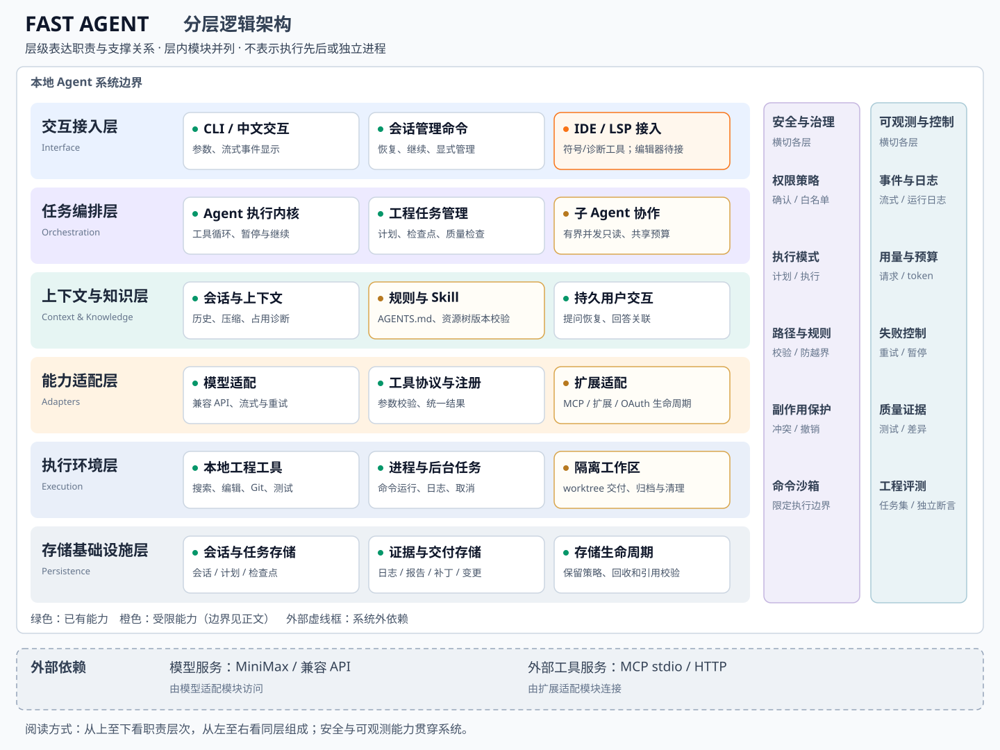

# Agent 分层架构

这是一篇进阶回顾。[由浅入深理解 agent 阅读路线](deep-dive/index.md)先用具体问题解释决策、上下文和恢复，再回到本图。建议先完成 [从修复测试理解 Agent](start-with-a-task.md)，并阅读工具、循环和会话章节，再用本图整理已学功能。无需在入门时记住这些层名。

Fast Agent 是一个本地工程 Agent 教学项目。模型提出下一步，宿主程序保存消息、校验参数、检查权限、执行工具并回传结果。**模型输出工具调用，不等于工具已经执行。**

本页基于当前实现描述逻辑分层。源码暂时保持平铺的 Python 模块，避免为了目录外观大规模移动和破坏教程链接。图中六个横向层级表达职责与支撑关系，同层模块并列；右侧安全治理、可观测与控制是横切能力，底部是系统之外的服务依赖。这里没有执行顺序箭头，也不代表六个独立进程。实线框表示已有模块，橙色框提示受限能力（具体边界见下表），底部虚线框表示系统外依赖。

## 分层架构图

[打开可缩放的 SVG 原图](assets/agent-architecture.svg)。图内文字可随浏览器缩放；以下表格同时提供可搜索的文字和代码入口。

### 图应该怎样读

- **纵向看职责**：交互接入 → 任务编排 → 上下文与知识 → 能力适配 → 执行环境 → 存储基础设施。下层提供支撑，不要求每个请求逐层经过。
- **横向看组成**：同层模块是不同职责，例如模型适配、工具协议和扩展适配互不代表执行顺序。
- **侧边看横切能力**：权限、模式、沙箱、日志、预算和失败控制分布在多个模块中，不是流程末尾的一站。
- **边界外看依赖**：MiniMax 和 MCP 服务不属于本地 Agent 内核。图中持久用户交互指可恢复提问，持久提问已有独立记录与恢复入口，区别于即时 ask_user。

### 参考来源与取舍

参考 [微软 AutoGen v0.4 官方分层架构图（Figure 1）](https://www.microsoft.com/en-us/research/blog/autogen-v0-4-reimagining-the-foundation-of-agentic-ai-for-scale-extensibility-and-robustness/) 对框架职责和外部应用边界的表达，以及 [Microsoft Agent Framework 的分层职责说明](https://learn.microsoft.com/en-us/agent-framework/concepts/agents/agent-pipeline)。这里采用的是分层表达方法；Fast Agent 的六层划分来自本项目代码，不表示实现了这些框架，也不是它们的复刻图。后者还包含请求管线图，本页不把请求管线作为整体架构。

## 模块职责与代码入口

| 层 | 核心职责 | 代码入口 | 当前边界 |
| --- | --- | --- | --- |
| 交互与组装 | 解析参数、配置模型和工具、显示事件、本地命令 | [cli.py](reference/src/fast_agent/cli.py.md)、[session_commands.py](reference/src/fast_agent/session_commands.py.md) | 本地命令不是模型工具 |
| Agent 循环 | 维护消息、调用模型、执行工具、暂停与继续 | [agent.py](reference/src/fast_agent/agent.py.md)、[models.py](reference/src/fast_agent/models.py.md) | 有限步数；没有全局异步调度器 |
| 模型网关 | 请求协议、流式解析、错误分类、重试和用量 | [providers.py](reference/src/fast_agent/providers.py.md)、[usage.py](reference/src/fast_agent/usage.py.md) | 已有请求预算、显式窗口估算与一次超限恢复；不自动发现供应商窗口 |
| 上下文 | 保存恢复、摘要压缩、历史裁剪与诊断 | [sessions.py](reference/src/fast_agent/sessions.py.md)、[compaction.py](reference/src/fast_agent/compaction.py.md) | 字符预算不是模型 token 窗口 |
| 工具协议 | 注册、参数验证、统一结果、输出限额 | [tools.py](reference/src/fast_agent/tools.py.md)、[tool_outputs.py](reference/src/fast_agent/tool_outputs.py.md) | handler 仍须检查路径和副作用 |
| 权限与边界 | 模式、确认、白名单、命令沙箱 | [permissions.py](reference/src/fast_agent/permissions.py.md)、[command_sandbox.py](reference/src/fast_agent/command_sandbox.py.md) | 沙箱只覆盖已接入的命令路径 |
| 扩展 | Skill、MCP、本地扩展 | [skills.py](reference/src/fast_agent/skills.py.md)、[mcp_tools.py](reference/src/fast_agent/mcp_tools.py.md) | 资源树版本与按需指纹；MCP 显式刷新及 OAuth 生命周期已接入，受控 HTTPS 管理器链路已验收；外部账户不在示例验证范围内，未作验证声明 |
| 工程工作流 | 工作区隔离、变更交付、子任务与质量检查 | [worktrees.py](reference/src/fast_agent/worktrees.py.md)、[delegation.py](reference/src/fast_agent/delegation.py.md)、[quality_checks.py](reference/src/fast_agent/quality_checks.py.md) | 支持有界并发只读委派；worktree 支持归档、恢复和确认后清理，不自动合并 |
| 证据存储 | 原子保存、读取校验、结果追溯 | [runtime_store.py](reference/src/fast_agent/runtime_store.py.md)、[delegation_reports.py](reference/src/fast_agent/delegation_reports.py.md) | 支持引用保护、隔离、恢复与到期清除；清理证据和保护引用无自动到期 |

## 一次任务如何经过这些模块

1. 用户输入任务，CLI 把任务交给 Agent；`/save` 等本地命令直接进入管理入口。
2. Agent 加入用户消息；检查上下文占用，在安全边界执行必要压缩。
3. 模型网关收到历史和工具定义，返回文本或带 ID 的 tool calls。这里没有直接写文件。
4. Agent 保存 assistant 消息；注册表校验参数，ToolContext 和工具内部检查权限、规则、路径及版本。
5. 工具执行后返回 ToolResult。大结果先落盘，历史中保留有界结果和读取引用。
6. 对应 tool 消息带上原 tool_call_id，送入下一轮。只有模型结束、达到限额、失败暂停或取消才退出循环。
7. CLI 展示结果；测试输出、差异、日志和报告提供核对依据。模型宣称“完成”仍需这些证据支持。

教学时建议沿 `cli → Agent.run → model.complete → registry.execute → ToolResult → Message(tool)` 阅读，然后再展开上下文和工程工作流。扩展能力不应绕过这条权限和证据路径。

## 执行与报告存储为什么分离

`delegation.py` 负责运行子任务，`DelegationReports` 负责格式校验、保存、分页列表和加载；底层文件操作继续复用 RuntimeStore。

`/delegate 任务` 创建报告，`/delegations [页码]` 每页列出 20 条摘要，`/delegation ID` 展示详细报告。两个查看命令不请求模型、不注入主会话、不重放工具；计划模式也能查看。列表按 ID 排序，最多扫描 1000 个候选文件；超限后用 ID 直接读取。损坏记录在列表中显示错误，不能把无效记录当作成功。

`completed=false` 必须保留；工具调用成功也不等于报告结论正确。保存主会话不会嵌入这些独立报告，报告的引用保护与回收规则见[存储回收](tutorial/46-storage-retention.md)。

## 核心能力与验证入口

下表将核心能力对应到实践教程与场景验证。验证范围以具体场景为准，不代表完整复刻 Claude Code，也不代表支持所有语言服务和 MCP 服务。

| 能力 | 已验收范围 | 证据与教程 |
| --- | --- | --- |
| 委派报告读取 | 独立存储、分页、无效记录拒绝、未完成状态保留；查看不调用模型 | 本地分页及无副作用测试；[报告汇总](tutorial/42-delegation-summary.md) |
| worktree 安全清理 | 归档/恢复、活动任务阻塞、未知状态核实、交付检查、确认后清理与证据恢复 | MiniMax 21/21；[归档恢复](tutorial/41-worktree-archive.md)、[安全清理](tutorial/44-worktree-cleanup.md) |
| 委派汇总与调度 | 来源引用、有界并发、独立客户端、共享预算、协作取消、持久批次核实 | MiniMax 8/8；[并发委派](tutorial/49-parallel-delegation.md) |
| MCP 与 OAuth 生命周期 | stdio/HTTP、状态、断开、刷新、重连、旧定义失效；公共客户端登录、刷新、登出和撤销 | MCP MiniMax 22/22，OAuth 管理器 6/6；本地 HTTPS 与代理链路；[连接管理](tutorial/43-mcp-lifecycle.md)、[OAuth](tutorial/50-mcp-oauth.md) |
| 上下文与 Skill 生命周期 | 资源树版本、变更失效、显式重载、窗口预算、工具配对、一次超限恢复与分段摘要 | Skill MiniMax 14/14，窗口预算 10/10，真实拒绝后恢复 8/8；[资源树](tutorial/47-skill-tree.md)、[窗口恢复](tutorial/48-window-recovery.md) |
| 持久提问与存储回收 | 保存恢复不误授权、一次性答复、过期检查、跨工作区引用保护、隔离/恢复与到期清除 | 提问 MiniMax 8/8，回收 11/11；[持久提问](tutorial/45-durable-questions.md)、[存储回收](tutorial/46-storage-retention.md) |
| 工程评测与 LSP | 独立质量断言、用量与未知费用、失败恢复评测；符号、定义、诊断与进程关闭 | LSP MiniMax 9/9，工程评测 2 任务 9 断言，恢复评测 7/7；[LSP](tutorial/51-lsp.md)、[评测](tutorial/52-engineering-evals.md) |

教程中的脚本用于复现各自的验证场景。完整报告、失败证据与运行环境保存在项目内 `plans/final-delivery.md` 和 `plans/final-evidence-matrix.md`；各场景通过不等于任意任务都能成功。

## 已有能力的边界

- **工作区与回收**：清理证据包、Git 保护引用和审计清单无自动到期，不提供删除唯一恢复证据的命令；清理不保证总磁盘占用下降。
- **委派**：当前为只读、有界并发和协作取消；不强杀已发送的远端请求，不自动重跑未知任务。
- **扩展**：OAuth 支持预注册公共客户端，不含动态注册和客户端密钥认证；外部真实账户不在示例验证范围内，不能称已验证。
- **上下文**：窗口估算不是精确 tokenizer，不自动发现供应商窗口；摘要可能丢失细节，Skill 校验不是文件系统快照。
- **工程工具**：LSP 工具不是编辑器插件；评测是限定任务集，不是任意大型仓库修复能力的证明。

图中橙色模块表示上述能力范围限制；阅读时应同时核对模块职责、使用方式与边界。